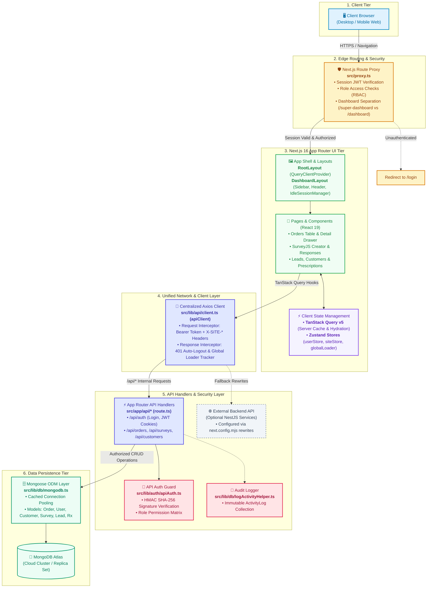

# MediPulse Portal — System Architecture Diagram

This directory contains the architecture documentation and interactive visual diagrams for the MediPulse Healthcare Admin Portal.

---

## 🎨 Interactive Architecture Diagram (Archify)

An interactive, animated diagram generated using **Archify** is available at:
👉 **[`medipulse-architecture.html`](./medipulse-architecture.html)**

- **Local Absolute Path:** `D:\New projects\1 MediPulse\docs\architecture\medipulse-architecture.html`
- **Features:** Zoom & pan, Dark/Light theme toggle, animated dataflow paths, interactive inspection cards, and component focus.

---

## 📊 System Flowchart (Mermaid)

---

## 🔍 Layer-by-Layer Architecture Details

1. **Client Tier**: Web browsers run React 19 UI with client components marked with `'use client'`.
2. **Edge Proxy (`src/proxy.ts`)**: Evaluates authentication before page rendering, verifying JWT cookie tokens and preventing cookie spoofing through token role validation.
3. **App Router Presentation Tier**: Nested layouts provide session inactivity monitoring (`IdleSessionManager`), site branding initialization, and responsive navigation.
4. **Network Tier (`apiClient`)**: Singleton Axios client automatically injects authorization tokens and multi-tenant site identifiers (`X-SITE-ID`, `X-SITE-KEY`, `X-SITE-HOST`).
5. **Backend Handlers & Auth Guard**: Next.js route handlers validate incoming requests with `verifyApiAuth` using the Web Crypto API HMAC SHA-256 engine.
6. **Persistence Tier**: Cached MongoDB connections prevent connection leaks during serverless hot-reloads, with typed Mongoose models enforcing schema integrity.
